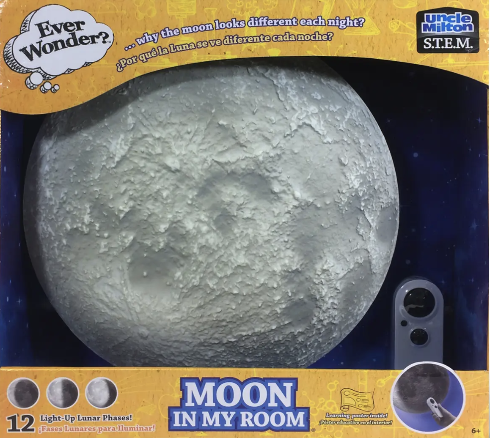
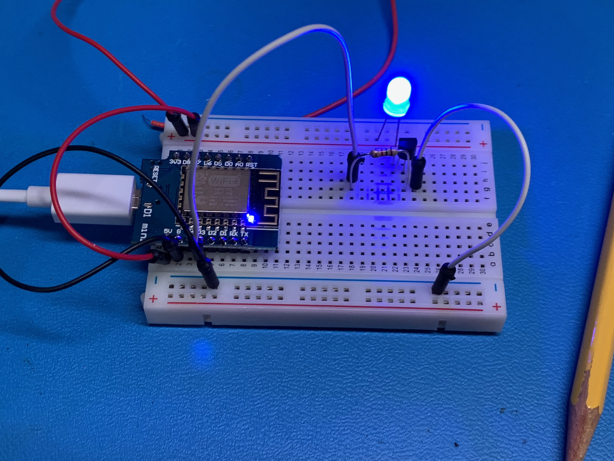
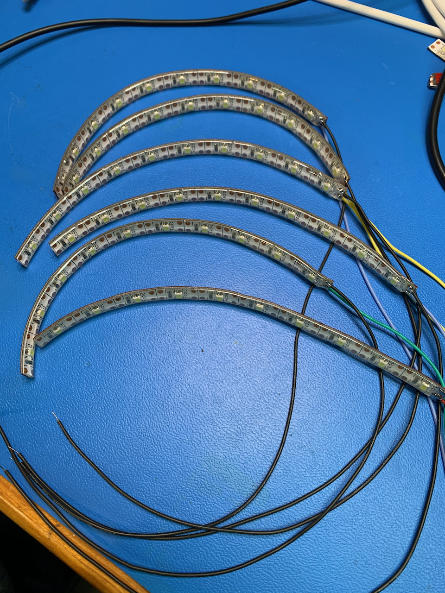
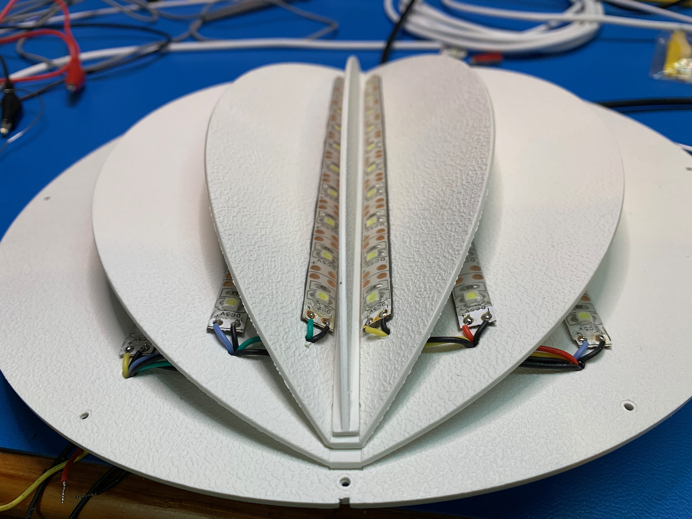
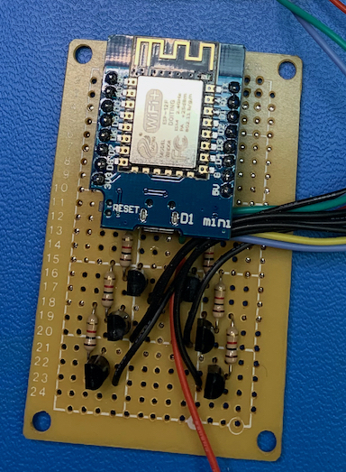
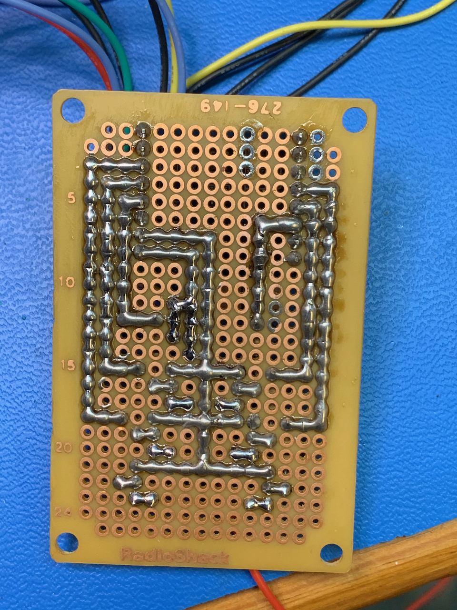
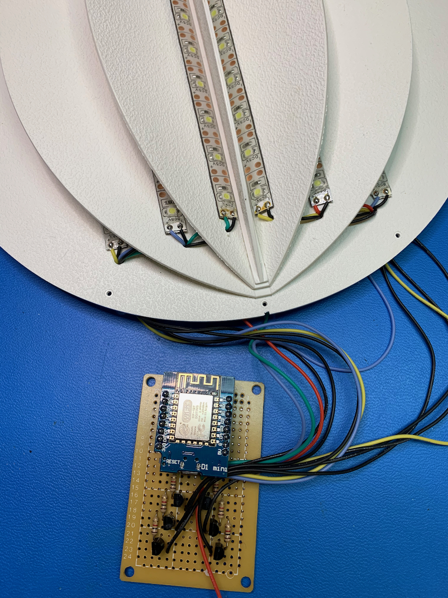
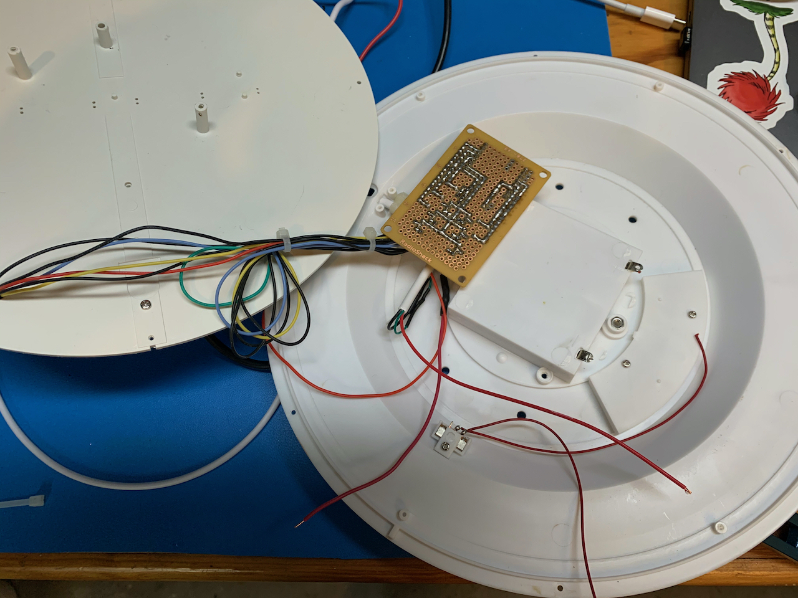
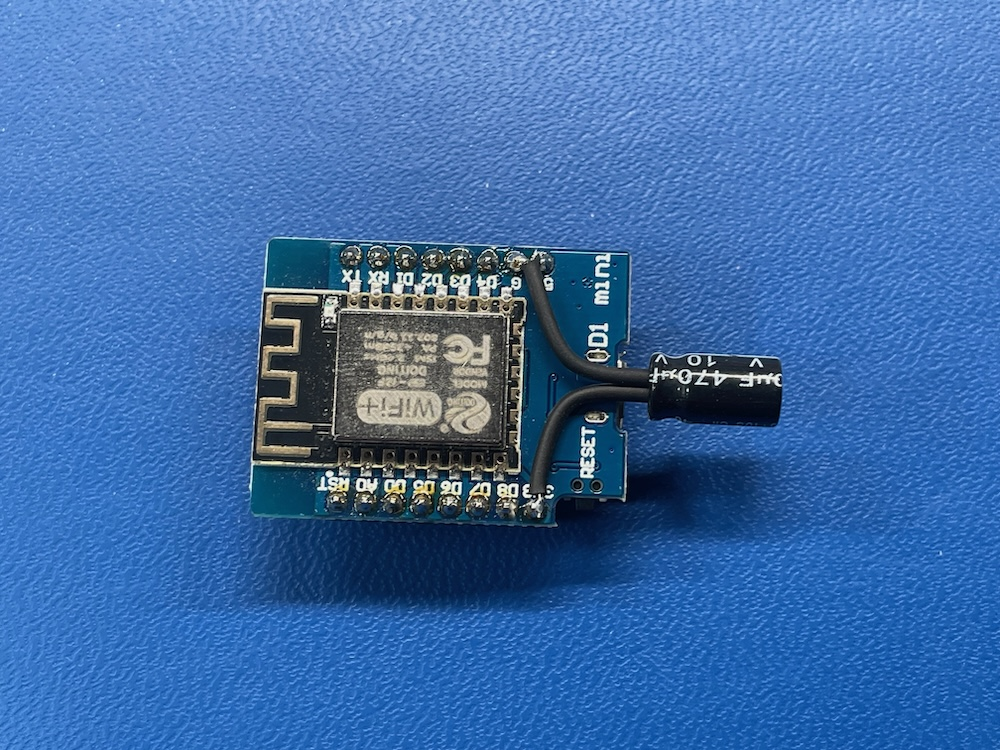

# Moonlight

Got some time in the electronics shop this past weekend, so I worked on my wifi-connected Moon Light. This started life as a nightlight for my son when he was young. As of October 2026, you can [still buy these](https://www.amazon.com/Uncle-Milton-Moon-My-Room/dp/B071NM2DZB/ref=sr_1_1).

It's been in storage for a while, and so I decided I wanted to make it wifi-connected in order for it to automatically set the phase of the moon. I also wanted to make it brighter so it can be seen in the daytime.

Step 1 was to use my favorite little wifi board with Wemos D1 mini. These things are [super cheap](https://www.amazon.com/Organizer-ESP8266-Internet-Development-Compatible/dp/B081PX9YFV), and you can write quick programs with using the Arduino environment. Because I was planning to drive a string of LEDs per moon segment, I needed to use a transistor to switch the extra current. Here's a quick breadboard test.

Next, I cut up some [LED strip lights](https://www.amazon.com/gp/product/B07SN3M8VW) that are 5V powered (the same voltage as the Wemos board) into strips for each phase of the moon. These replaced the single LED that lit each phase in the original nightlight.

Next was to populate a board. Nothing fancy on this job. A quick one-off project isn't really worth laying out and spinning a board. So I just used an old project board with traces made from solder.

Then, final reassembly

I wrote a [quick program](https://github.com/dgaff/moonlight/blob/main/moonlight.ino) to sweep through the phases. I still need to write the wifi connected part, and I want to put a simple web api on it so I can remotely control.

**There are no new ideas, of course.**

Unsurprisingly, everything in code has already been solved and there's a [moon phase](https://www.arduino.cc/reference/en/libraries/moonphase/) library already for Arduino. So the rest of this project is mostly cut-and-paste code. Also unsurprisingly, after I embarked on this project, I found out that someone on Instructables [also had this idea](https://www.instructables.com/Arduino-Controlled-Model-Moon-synchronizes-phase-c/), too. They took a different approach, though, favoring a real time clock and keeping it more as a night-light on battery power.

**Updates for 2026**

The light had an annoying habit of randomly resetting and going through its startup sequence again. I unplugged it and didn't bother to figure out why. When I came back to this project recently, I first had to convert this to use the PlatformIO vscode Extension, which is the preferred way to build Arduino in vscode. This required a little bit of library updating. The original .ino file is still in the repo, but the correct file is main.cpp.

Some sleuthing and help from Claude led me to discover that the voltage regulator can dip when there is wifi activity, causing the serial port chip to reset. This manifests as the serial port appearing and disappearing on the laptop. Claude suggested a 100-470 uF electrolytic cap from 3.3V to GND (or lowering the wifi power, which you'll see commented out in the code.) I put 470 uF to be safe, and it fixed the problem. No more serial disconnects. I suspect the power dipping was also causing the board to reset sometimes, too.

There's some additional information in resetnotes.md about how the board is put into programming mode and some dangers of driving certain pins. I didn't seem to be having a problem with this, but I kept the notes for future reference.
